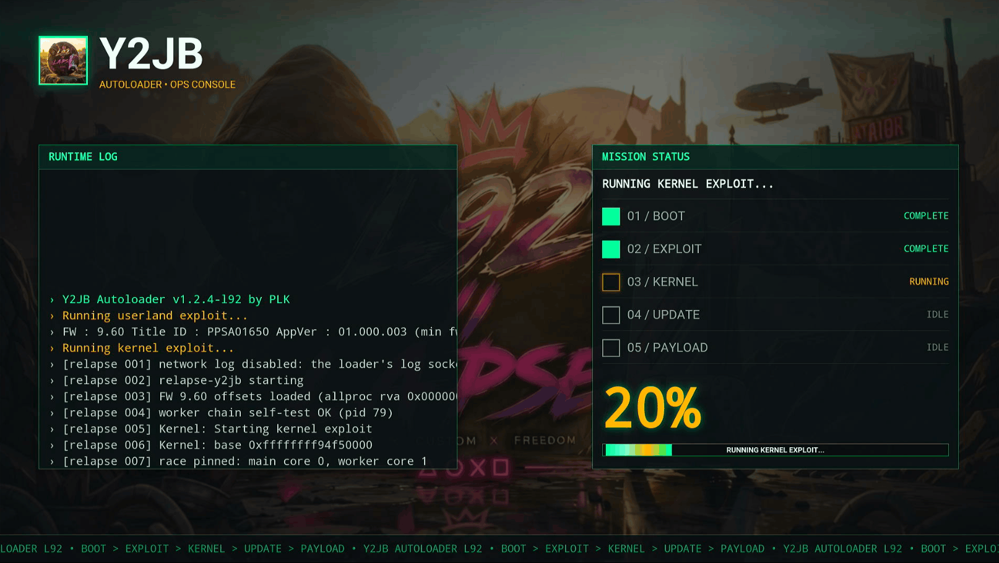

<p align="center">
 
</p>
<h1 align="center">Y2JB Autoloader — L92 build</h1>
<h3 align="center">L92 build — kernel exploit + payload autoloader</h3>
&nbsp;
<p align="center">Kernel exploit + automatic payload loading for PS5.<br>Supports PS5 firmwares 4.03 - 13.60</p>

<p align="center">
 
</p>

## What this build is

This repository carries the **L92 project** — the *Ops Console* HUD, the autoloader chain and the
Relapse/Lapse routing. Everything is started from the YouTube app, so installation and the update
flow stay the same.

What you get:

- **Ops Console HUD** — a full-screen interface (runtime log terminal, live step checklist,
  big progress readout, segmented bar) drawn by `src/main.js`, with the background and icon
  embedded as data-URLs so they always render in Cobalt.
- **Autoloader** — once the exploit lands, the kernel loader (kexp + elfldr) runs and your
  payloads are sent automatically, or the **Payload Manager** web UI is started when nothing is configured.
- **Exploit routing** — Relapse for FW 7.00 - 13.60 (network interface required, Lapse fallback on
  7.00 - 10.01 without network), Lapse for FW <= 10.01.
- **Speed** — native bulk-memory copies instead of per-byte fake-RW loops (update zip extraction,
  file writes, icon compare) and a batched log repaint.
- **Background / icon sync** — your `background.png` is written as `pic1.png` and `icon0.png` as the
  dashboard icon in `/user/appmeta/<TITLE_ID>/`, with read-back verification.
- **Robust update flow** — `y2jb_update.zip` sanity checks (zip signature, 0-file extraction abort),
  retries when acquiring the V8 primitives, longer ELF-loader wait window.

The interface is previewable in a normal browser: open [preview_ui.html](preview_ui.html).

## Installation

### Jailbroken PS5 (WebKit, Lua, BD-JB)

Install YouTube (`PPSA01650` / `PPSA01651` / `PPSA01652`):

| Firmware | YouTube Version |
| :--- | :--- |
| **4.03 - 12.40** | `v01.000.003` |
| **12.60 - 13.20** | `v01.000.030` |
| **13.40 - 13.60** | `v01.009.253` |

Then FTP `download0.dat` from the [Releases page](https://github.com/notmaj0r/Y2JB/releases) to
`/user/download/PPSA0165*/` (create the folder if needed).

> **DNS note:** set the PS5 DNS to `127.0.0.2` (Settings > Network > Set Up Internet Connection >
> Manual > DNS Settings). This blocks PSN, which stops YouTube and firmware update prompts from
> interfering with the exploit. A network/PSN error message is expected and harmless.

### Non-Jailbroken PS5

Restore a Y2JB system backup, then place `download0.dat` from the Releases page in
`/user/download/PPSA01650` with FTP, or install a YouTube app from another region and place it in
`/user/download/PPSA0165*/`.

## How to use the autoloader

### Option 1: Payload Manager (nothing to configure)

If no `autoload.txt` config is found, the **Payload Manager** web UI starts automatically, so you can
send payloads from your browser without preparing files in advance.

### Option 2: Manual config (`autoload.txt`)

- Create a directory named `ps5_autoloader`.
- Inside it, place your `.elf` / `.bin` files and an `autoload.txt`, one filename per line
  (names are case-sensitive). Add lines like `!1000` to wait 1000 ms before the next payload.
- Put `ps5_autoloader` on the **root of a USB drive** or in **`/data/ps5_autoloader`** (USB wins).

> **Note:** when an `autoload.txt` is found, Payload Manager is **not** started. Add `pldmgr.elf`
> to `ps5_autoloader` and to `autoload.txt` if you want both.

## How to update

Place **`y2jb_update.zip`** from the [Releases page](https://github.com/notmaj0r/Y2JB/releases)
on a USB drive and start the app: the HUD performs the update, re-verifies the written files and
reports the result in the runtime log.

Accepted locations (first match wins):

- `/mnt/usbN/y2jb_update.zip` (USB root)
- `/mnt/usbN/ps5_autoloader/y2jb_update.zip`
- `/data/y2jb_update.zip`
- `/data/ps5_autoloader/y2jb_update.zip`

The file name must match exactly.

## Extras

- `appinfo_editor.py` — blocks YouTube updates by patching `appinfo.db` (**backup your savedata
  first**: a corrupted database can wipe installed FPKGs and savedata).
- `log_server.py` — tiny HTTP log server; point `LOG_SERVER` in `src/main.js` at your PC to mirror
  the HUD log over the network.
- `payloads/payload_sender.py` — send a payload to a listening ELF loader from your PC.
- `scripts/create_update_package.py` — MIT-licensed packaging script (see its header), builds `y2jb_update.zip`.

## Build from source

Binaries (elfldr, kexp, unified autoloader) are bundled in `src/`, so no submodule checkout is needed:

```bash
./build.sh --stable      # or --dev
# produces y2jb_update.zip with @@VERSION@@ / @@ELFLDR_FILE@@ / @@KEXP_FILE@@ substituted
```

The GitHub workflows build `y2jb_update.zip` and generate the UFS2 `download0.dat` image used for
installation.

### Custom autoload configs per YouTube app

Name the directory `ps5_autoloader_[TITLE_ID]` (e.g. `ps5_autoloader_PPSA01650`) to keep a different
`autoload.txt` per app; those directories always take precedence over the generic one.

### Using your own ELF loader

By default the autoloader ships a localhost-only elfldr. To use your own, drop it in
`ps5_autoloader`, list it in `autoload.txt`, and add a sleep (e.g. `!4000`) before the next payload.

## Credits

- **[L92](https://github.com/notmaj0r)** — Ops Console HUD, autoloader chain, Relapse/Lapse routing,
  update and icon sync
- Third-party components keep their own notices in the source files: Lapse and Relapse derivations,
  elfldr, kexp, the unified autoloader and the payload manager, plus the references they build on
  (psfree/Lapse team, shahrilnet, null_ptr, BenNoxXD, ntfargo, flat_z, LM, john-tornblom,
  EchoStretch, hammer-83, zecoxao, idlesauce, TheFlow, ufm42, Dr.Yenyen and the PS5 R&D community)

## License

This project is licensed under the **GPL-3.0 License**.
The upstream base code remains under its original **MIT License** (see [LICENSE-MIT](LICENSE-MIT)).
All unique modifications and additions by L92 are licensed under **GPL-3.0**.
Per-file third-party copyright notices are listed in [THIRD_PARTY_NOTICES.md](THIRD_PARTY_NOTICES.md).

## Disclaimer

This tool is provided as-is for research and development purposes only. Use at your own risk.
The developers are not responsible for any damage, data loss, or consequences resulting from its use.

## Donate

- see [DONATE.md](DONATE.md)
